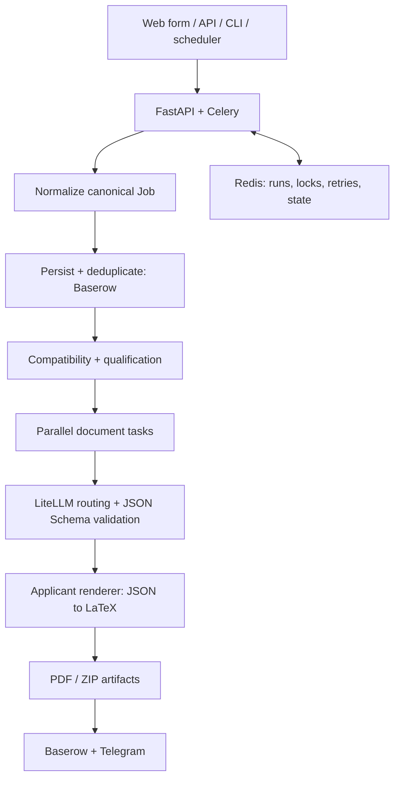

# Job Hunt Automation

**Portfolio edition of a multi-tenant, AI-assisted job discovery and application pipeline.**

Python 3.12 · FastAPI · Celery · Redis · LiteLLM · Baserow · Docker · JSON Schema · LaTeX

> **Privacy:** All applicant profiles in this repository are fictional. The original
> production repository, personal CVs, service credentials, and operational data
> remain private. This repository has independent Git history.

## What the system does

1. Ingests jobs from web forms, manual submissions, external job APIs, and scheduled discovery.
2. Normalizes job details into a canonical domain model and deduplicates submissions.
3. Applies compatibility gates and configurable qualification scores.
4. Routes structured LLM tasks through logical capability groups, with schema validation,
   bounded repair, fallback, and retry behavior.
5. Generates tailored CV and cover-letter JSON, LaTeX, and PDF documents.
6. Stores results and state with Baserow and Redis, and delivers notifications via Telegram.

## Architecture



## Explore the project

| Area | What to inspect |
| --- | --- |
| [Application](src/job_hunt/application) | Canonical intake, normalization, triage and orchestration |
| [Integrations](src/job_hunt/integrations) | External providers, LLM gateway, schema handling, job discovery |
| [Queue workers](src/job_hunt/worker.py) | Bounded async jobs, retry and notification ownership |
| [Rendering](src/job_hunt/rendering) | LaTeX document production and applicant-specific strategies |
| [Tests](tests) | Unit, contract and integration behavior |
| [System notes](docs/architecture.md) | Dependency boundaries and design decisions |

## Offline demonstration

The repository includes fictional applicant profiles and sample jobs. No credentials
or external accounts are needed for the self-contained portfolio demo:

```bash
uv sync --extra dev
uv run python examples/demo.py --output runs/demo
```

The offline demo illustrates normalization, eligibility signals, transparent scoring,
and a deterministic application decision. It is **not** a substitute for the full
production provider integrations or live PDF workflow.

For the full service stack, copy `.env.example` to `.env`, configure external
services, and follow [Local development](docs/local-development.md).

## Engineering highlights

- **Distributed execution:** Separate fast, document-generation and notification queues.
- **Reliability:** Redis-backed resumable tasks, idempotent persistence, explicit
  retries, rate-limit handling and deliberate provider fallback.
- **LLM robustness:** Capability-group routing via LiteLLM, strict JSON Schema validation,
  structured-output repair, and preservation guards.
- **Data contracts:** Typed domain models, config validation and provider-neutral ports.
- **Deployment:** Multi-stage Docker builds, Compose services and quality-check automation.
- **Security:** SSRF-aware remote content retrieval, safe LaTeX generation boundaries,
  scoped credentials, and synthetic public fixtures.

## Scope and trust

The public repository preserves the reusable architecture. All users, CV content and
demonstration data are synthetic. API credentials are never bundled. External
integrations require your own accounts and configuration.

The fictional tenants are **Atlas** and **Nova**. They exercise the project's two
distinct CV rendering formats without disclosing any real applicant data.

See [Privacy and publication policy](docs/privacy.md) and
[Future production integration](docs/public-private-integration.md).

## Technical documentation

- [Architecture](docs/architecture.md)
- [Local development](docs/local-development.md)
- [Privacy and data separation](docs/privacy.md)
- [Future public/private dependency integration](docs/public-private-integration.md)
- [Repository safety checks](docs/security.md)
