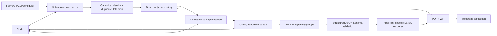

# System architecture

This is a multi-tenant, queue-backed application. The core implementation is in
`src/job_hunt`, and the public tenants are **fictional**.

## Major boundaries

- `domain/`: typed job, qualification, submission and output models.
- `application/`: discovery, normalization, triage and workflow orchestration.
- `ports.py`: adapters depend on abstract capability contracts.
- `integrations/`: Baserow, Apify, Bright Data, Telegram and LLM gateway.
- `worker.py`: Celery queues and resumable, bounded background execution.
- `rendering/`: safe LaTeX escaping, renderer strategies and PDF generation.
- `tenants/`: synthetic fixtures, not live identities or secrets.

The production path can use LLMs for job extraction, scoring, project selection,
section rewrites and cover letters. It validates JSON against an output schema,
attempts structural repair, and rejects repairs that violate preservation guards.

## Reliability features

Run identity and checkpoints live in Redis; Baserow stores long-lived job records.
Automatic reprocessing is intentionally different from retry of a known run.
Notifications have a separate queue so a notification outage does not require
regenerating the documents. The gateway groups models by capability and applies
configurable fallbacks after a retryable provider error.

## Practical trade-offs

- The public demo is offline, deterministic and synthetic. It uses real domain
  models but not live Apify/Baserow/LLM/Telegram accounts.
- JSON output repair currently has heuristics for semantic preservation, not a
  formal guarantee that every original token is unchanged.
- The worker remains intentionally large and is excluded from a few formatting
  or coverage checks in the inherited project.
- Full multi-service deployments require credentials and external tables that are
  deliberately **not** included in this repository.
